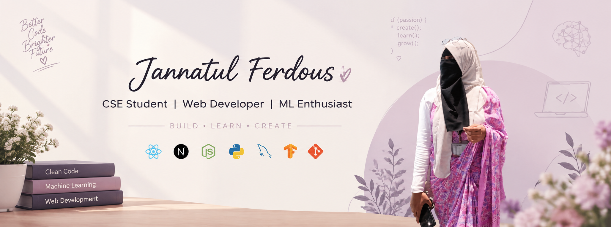

 

# 👋 Hi, I'm Jannatul Ferdous

### Computer Science & Engineering Student | Web Developer | ML Enthusiast

📍 Dhaka, Bangladesh

---

## 👩‍💻 About Me

I'm a **Computer Science and Engineering student** passionate about building practical software solutions and exploring intelligent technologies.

I enjoy developing web applications, solving programming problems, and exploring Machine Learning and Deep Learning. I love learning new technologies and turning ideas into real-world projects.

- 🎓 Studying Computer Science & Engineering
- 💻 Interested in Full-Stack Web Development
- 🤖 Exploring Machine Learning and Deep Learning
- 🔬 Working on multimodal breast cancer research
- 🌱 Continuously learning and improving my technical skills

---

## 🚀 What I'm Currently Working On

- 🌱 Exploring **Next.js** and modern full-stack development.
- 💻 Developing web applications using React and PHP.
- 🔬 Working on a **Multimodal Breast Cancer Research Project** integrating Histopathology, Clinical, and Genomic data.
- 🤖 Exploring Deep Learning architectures and Machine Learning models.
- 📚 Improving my software engineering and problem-solving skills.

---

## 🛠️ Technical Skills

## 🛠️ TECHNICAL SKILLS

### 💻 Programming Languages

  

C, C++, Python (Basic), JavaScript (ES6), TypeScript, SQL

### 🌐 Frontend Development

  

React.js, Next.js, HTML5, CSS3, Tailwind CSS, daisyUI

### ⚙️ Backend Development

  

Node.js, Express.js, REST APIs, JWT Authentication

### 🗄️ Databases

  

MongoDB, MySQL

### 🤖 AI / Machine Learning

  

Deep Learning, Multimodal Learning, Data Processing, Model Training & Evaluation, LLM Agent Security

### 🔧 Tools & Platforms

  

Git, GitHub, VS Code, Vercel

## 🌐 Connect With Me

  
  
  
  

---

## 📊 GitHub Statistics

---

## 🔥 Contribution Streak

---

## 🚀 Featured Projects

---

## 💡 Areas of Interest

- Full-Stack Web Development
- React & Next.js
- Machine Learning & Deep Learning
- Artificial Intelligence
- Data Analysis
- Multimodal AI Research
- Software Engineering

---

### ✨ Build • Learn • Create ✨

*Always curious, always learning, always building.*

Thanks for visiting my profile! 💜

